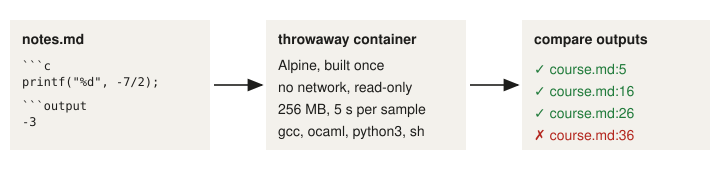

# cobaye

Run the code samples of a course, a README or an exercise bank in a throwaway container, and check that each one
prints what the text says it prints. C, OCaml, Python and shell. One Python file, no dependency besides Docker
(or Podman).



*Cobaye* is French for guinea pig: your examples go through the test before your students or readers do.

Written for [EPITA Doomscrolling](https://epitadoomscrolling.pierref.eu), an exam training site for EPITA prépa
students, where every C and OCaml answer is run before it is published. By
[Morgan Pierrefeu](https://morgan.pierref.eu).

## Why

A course says `-7 / 2` gives `-3` in C, or that an OCaml phrase answers `- : int = 123`. One typo and students
learn something false. Running the samples by hand after each edit does not last. cobaye reads the samples
where they already are and runs them all at once.

## Use

Write the expected output right after the code, in a block tagged `output`:

````markdown
```c
#include <stdio.h>
int main(void) { printf("%d %d\n", 7 / 2, -7 / 2); return 0; }
```

```output
3 -3
```
````

```bash
python3 cobaye.py examples/course.md
```

```text
✗ examples/course.md:36 (c)
--- expected
10
--- got
2

3/4 samples OK
```

The exit code is 1 when a sample fails, so it fits in CI or a pre-commit hook. `--list` shows the samples found
without running them.

Block tags: `c`; `ocaml` (or `ml`, `caml`); `python` (or `py`); `sh` (or `bash`). Any other block is ignored.

### JSON input

For an exercise bank kept as data:

```json
[{"lang": "ocaml", "code": "let rec f n = if n = 0 then 1 else n * f (n - 1);;\nf 5;;",
  "expected": "val f : int -> int = <fun>\n- : int = 120"}]
```

### From Python

```python
import cobaye

bad = cobaye.run([{"lang": "python", "code": "print(2 ** 10)", "expected": "1024"}])
assert not bad
```

## How it runs

- One Alpine 3.20 image with only the needed packages (`gcc musl-dev`, `ocaml`, `python3`), built on the first
  run and cached as `cobaye:<hash>`.
- One container for all samples: `--network none`, read-only root, 256 MB of memory, 64 processes, 5 s per
  sample.
- C: `gcc -std=c99 -w`, then the program. OCaml: one toplevel per sample, warnings off, so the answers look
  like the ones in a course (`val f : int -> int = <fun>`). Python: `python3`. Shell: `sh`.
- Outputs are compared with all whitespace collapsed. OCaml banners and error position lines are dropped.

Add a language by adding one line to `LANGS`: Alpine packages, file extension, shell command.

## Tests

```bash
python3 -m unittest tests/test_cobaye.py   # the container test is skipped without Docker
```

## License

MIT
